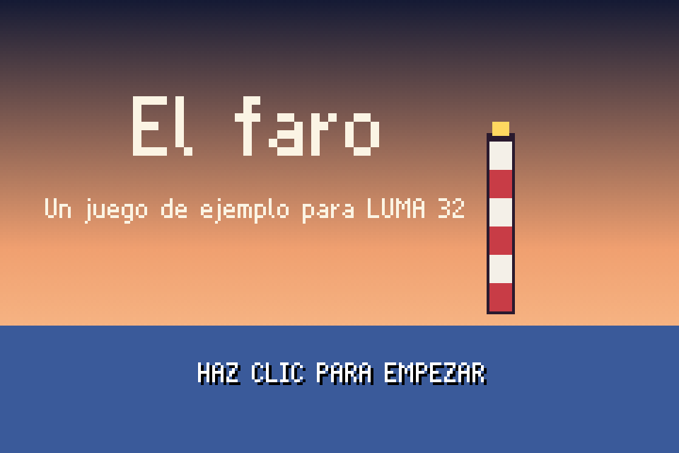
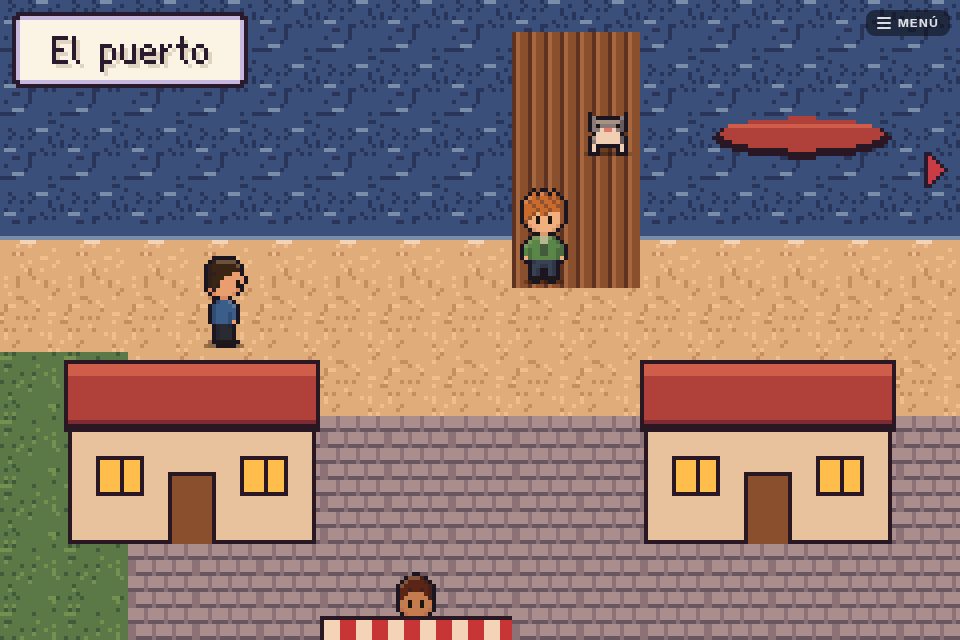
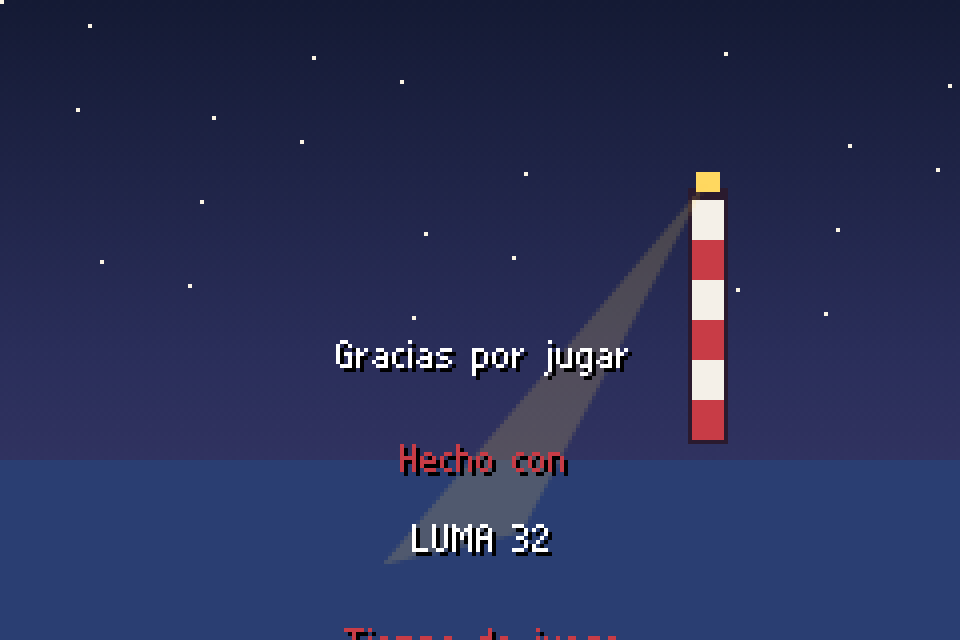

# El faro — an example game for LUMA 32

<p align="center">
  
  
  
</p>

A short game for [LUMA 32](https://github.com/dcimorra/luma32), the console that only exists
in the browser: the lighthouse keeper's matches got wet, and the night is coming. Ten
minutes, two places, four characters — and this repository is mostly here to show **how a
LUMA 32 game is made and shared**. Copy it to start yours.

## Play it

- **On [luma32.com](https://luma32.com)**: account → *Mis juegos* → *Desde GitHub* →
  `dcimorra/luma32-example`.
- **On your computer**, with the engine:

  ```sh
  git clone https://github.com/dcimorra/luma32 && cd luma32
  node tools/add-game.mjs dcimorra/luma32-example
  node server/serve.mjs          # http://localhost:8765/
  ```

## What a game is

A folder with a `game.js` that default-exports the cartridge (README of the engine, "A
cartridge"), and whatever it imports. No build step, no dependencies, no image files: art
is painted in code, music is notes.

```
luma.json          what a console shows before running the game (optional)
game.js            the manifest: title, theme, maps, songs, the start, dev jumps
story.js           the story's thread — one counter flag — and where things are
cast.js            people and animals, as doll specs
art/palette.js     every colour
art/tiles.js       every tile and prop, painted with the engine's Painter
art/views.js       full-screen pictures (title, cover, credits)
maps/harbor.js     one file per place: ground, props, people, doors, spots, scripts
maps/lighthouse.js
music.js           songs and ambiences
locales/es/        every word the player reads, by key
```

The rules that make it load anywhere:

- **`game.js` at the root of the repository** (or of a folder in it: then players add
  `owner/repo/folder`).
- **Import the engine as `../../engine/…`.** While you make the game it sits in
  `public/games/<id>/` of an engine checkout; luma32.com serves it at the same depth.
- **No words in the code.** Scripts pass keys (`api.say('marta', 'harbor.marta_ask')`) and
  `locales/es/common.json` has the text. Another language is another file.
- **Only what runs is shipped**: `.js`, `.json`, images, fonts, audio. Notes (`.md`),
  references and tests stay in the repository and are left out when the game is loaded.

### `luma.json`

```json
{
  "id": "el-faro",
  "title": "El faro",
  "author": "LUMA 32",
  "support": "https://github.com/dcimorra/luma32-example/issues",
  "homepage": "https://github.com/dcimorra/luma32-example"
}
```

`id` must be the one `game.js` declares: saves are kept under it, so keep it the same across
versions. `support` is where a player's "Reportar un problema" takes them; for a game
loaded from GitHub, without it, the repository's issues.

## Make yours

1. Clone the engine and this repository side by side, and link yours into the engine:

   ```sh
   git clone https://github.com/dcimorra/luma32
   git clone https://github.com/dcimorra/luma32-example my-game
   cd luma32 && node tools/add-game.mjs ../my-game   # linked: your edits are what plays
   node server/serve.mjs
   ```

2. Change the `id` in `game.js` and `luma.json`, then everything else. Open
   `http://localhost:8765/?game=<id>&dev=1`: `?game=` skips the shelf, `dev=1` offers the
   game's dev jumps on its title.
3. Check it as a player would get stuck: `node tools/audit.mjs "http://localhost:8765/?game=<id>"`
   (in the engine; `cd tools && npm install` once) visits every dev jump and lists what is
   unreachable, missing or wrong.
4. With [Claude Code](https://claude.com/claude-code), open the engine's folder and ask for
   a game: its `luma32-games` skill knows how they are made.

## Publish it

Push it to a public GitHub repository. That is all: anybody can add `owner/repo`. Tag
releases (`git tag v1.0 && git push --tags`) so players can add a version that does not
change under them (`owner/repo@v1.0`); a later version keeps their saves as long as the `id`
stays and, if what the flags mean changes, `game.js` has a `version` and a `migrate`.

## License

MIT, like the engine: take it apart, copy it, make it yours.
